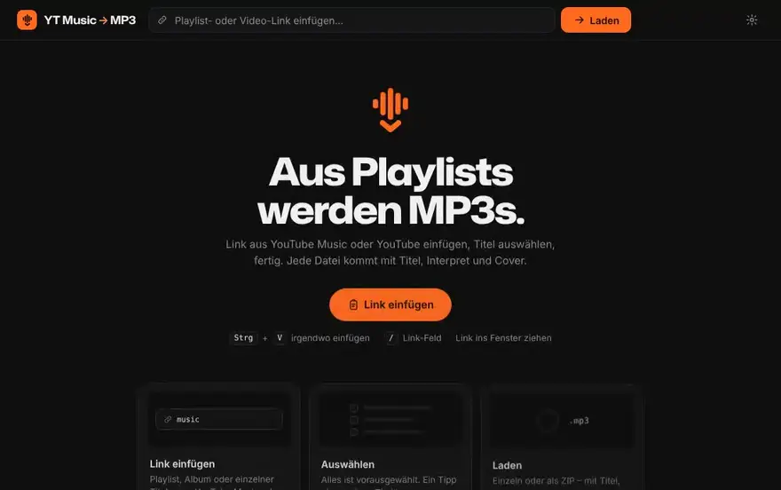
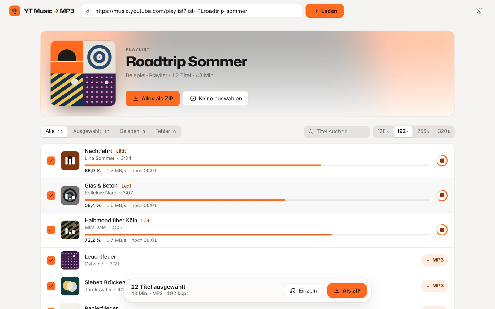
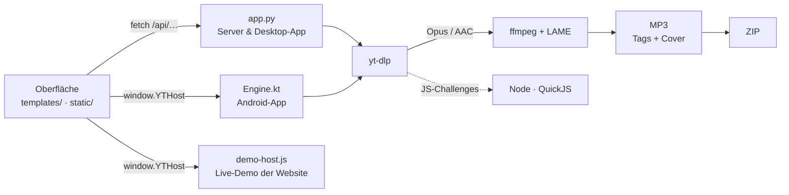
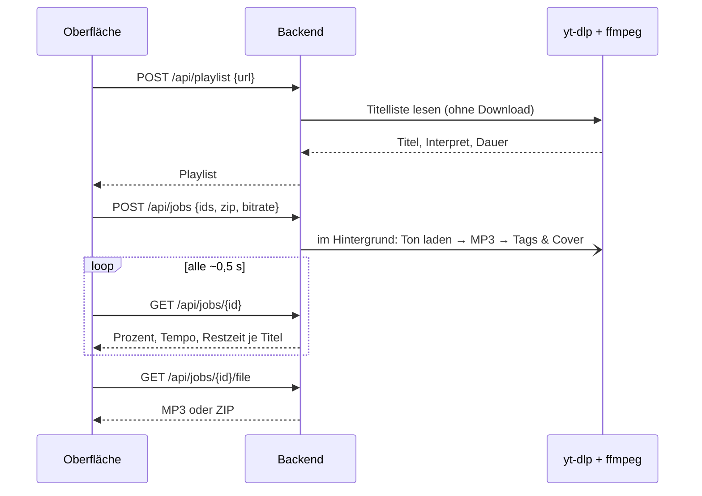

<div align="center">

<picture>
  <source media="(prefers-color-scheme: dark)" srcset="docs/readme/hero-dark.svg">
  
</picture>

<br>

[](https://github.com/Emre1001/Ytms-to-mp3/releases/latest)
[](https://github.com/Emre1001/Ytms-to-mp3/actions/workflows/build.yml)
[](LICENSE)


**[Website](https://emre1001.github.io/Ytms-to-mp3/)** ·
**[Download](#download)** ·
**[Live-Demo im Browser](https://emre1001.github.io/Ytms-to-mp3/#designs)** ·
**[So funktioniert’s](#so-funktionierts)** ·
**[Fragen](#fragen)**

</div>

<br>

Link aus YouTube Music einfügen, Titel auswählen, fertig. Jede Datei kommt als MP3 mit
**Titel, Interpret, Album und Cover** – einzeln oder alle zusammen als **ZIP**.
Kein Konto, keine Werbung, kein Tracking. Läuft auf deinem Gerät.

<p align="center">
  
  <br><sub>Die echte Oberfläche, hier mit Beispielmusik. Selbst ausprobieren: <a href="https://emre1001.github.io/Ytms-to-mp3/#designs">Live-Demo</a>.</sub>
</p>

## Download

| System | Datei | |
|---|---|---|
| **Windows 10 / 11** | [**YT-Music-MP3-windows-x64-Setup.exe**](https://github.com/Emre1001/Ytms-to-mp3/releases/latest/download/YT-Music-MP3-windows-x64-Setup.exe) | Doppelklick – installiert sich und startet. |
| **Android 10+** | [**YT-Music-MP3-android-arm64.apk**](https://github.com/Emre1001/Ytms-to-mp3/releases/latest/download/YT-Music-MP3-android-arm64.apk) | Fast alle Handys. Ältere: [armv7](https://github.com/Emre1001/Ytms-to-mp3/releases/latest/download/YT-Music-MP3-android-armv7.apk) |
| **Linux** (alle) | [**YT-Music-MP3-linux-x86_64.AppImage**](https://github.com/Emre1001/Ytms-to-mp3/releases/latest/download/YT-Music-MP3-linux-x86_64.AppImage) | `chmod +x` und starten. |
| **Debian / Ubuntu / Mint** | [**YT-Music-MP3-linux-amd64.deb**](https://github.com/Emre1001/Ytms-to-mp3/releases/latest/download/YT-Music-MP3-linux-amd64.deb) | `sudo apt install ./YT-Music-MP3-linux-amd64.deb` |

Alles ist eingebaut – Python, `yt-dlp`, `ffmpeg`. Nichts extra installieren.
Alle Dateien und Prüfsummen: [Releases](https://github.com/Emre1001/Ytms-to-mp3/releases/latest).

<details>
<summary><b>Windows sagt „Der Computer wurde durch Windows geschützt“?</b></summary>

<br>

Die App ist nicht mit einem kostenpflichtigen Zertifikat signiert. Klick auf **Weitere Informationen → Trotzdem ausführen**.
Der gesamte Code und jeder Build sind öffentlich: [Actions](https://github.com/Emre1001/Ytms-to-mp3/actions/workflows/build.yml).

</details>

<details>
<summary><b>Android: So kommt der Link am schnellsten in die App</b></summary>

<br>

1. APK öffnen und installieren (beim ersten Mal fragt Android, ob dein Browser Apps installieren darf – einmal erlauben).
2. In der YouTube-Music-App bei einer Playlist oder einem Song auf **Teilen** tippen.
3. **YT Music MP3** wählen – die Playlist ist sofort offen.

MP3s landen in `Musik/YT Music MP3` und sind direkt in jedem Musik-Player. ZIPs landen in `Download/YT Music MP3`.
Downloads laufen mit Benachrichtigung im Hintergrund weiter.

</details>

## So funktioniert’s

<picture>
  <source media="(prefers-color-scheme: dark)" srcset="docs/readme/flow-dark.svg">
  
</picture>

1. **Link rein.** Playlist, Album, Mix oder ein einzelner Song – aus YouTube Music oder YouTube. Einfügen mit <kbd>Strg</kbd>+<kbd>V</kbd> irgendwo im Fenster, per Ziehen oder auf dem Handy über *Teilen*.
2. **Erst die Liste.** [`yt-dlp`](https://github.com/yt-dlp/yt-dlp) liest nur das Inhaltsverzeichnis – Titel, Interpret, Dauer, Cover – ohne einen Song zu laden. Darum steht auch eine Playlist mit 100 Titeln nach Sekunden da.
3. **Nur der Ton.** Für jeden ausgewählten Titel wird die beste Tonspur geholt (meist Opus, sonst AAC) – kein Video, kein fremder Server dazwischen. Drei Titel gleichzeitig, mit echtem Fortschritt: Prozent, Tempo, Restzeit.
4. **Fertig als MP3.** `ffmpeg` wandelt mit LAME in MP3 um (128–320 kbps, du wählst), schreibt Titel, Interpret und Album hinein und schneidet das Cover aufs Quadrat zu. Dateiname: `Interpret - Titel.mp3`.
5. **Alles in eine ZIP.** Ist ein Song gesperrt oder gelöscht, läuft die ZIP trotzdem durch – `_Uebersprungene Titel.txt` sagt dir, welcher fehlt und warum.

### Warum das gut ist

- **Alles bleibt bei dir.** Die App läuft auf deinem Gerät und spricht nur mit YouTube. Kein Konto, keine Werbung, kein Tracking.
- **Bleibt von selbst aktuell.** YouTube ändert ständig etwas. Die App holt sich einmal am Tag das neueste `yt-dlp` (mit Prüfsumme) – am Computer aktiv ab dem nächsten Start, auf Android sofort.
- **Ehrlich.** Fortschritt kommt direkt vom Download, Fehler werden auf Deutsch erklärt, und 320 kbps macht eine Quelle nicht besser, als sie ist – 192 kbps ist der Standard.
- **Schlank.** Statt eines kompletten ffmpeg (~150 MB) steckt ein eigener Build drin, der nur Audio → MP3 und Cover kann (~5 MB).
- **Vier Designs.** Standard, Glas, ASCII und Split-Flap, jeweils hell und dunkel, mit eigener Akzentfarbe und drei Animationsstufen.

<picture>
  <source media="(prefers-color-scheme: dark)" srcset="docs/readme/app-dark.webp">
  
</picture>

### Tastenkürzel

| Taste | Wirkung |
|---|---|
| <kbd>Strg</kbd>+<kbd>V</kbd> | Link irgendwo im Fenster einfügen – lädt sofort |
| <kbd>/</kbd> | Ins Link-Feld springen |
| <kbd>Strg</kbd>+<kbd>A</kbd> | Alle Titel auswählen / abwählen |
| <kbd>Shift</kbd>+Klick | Ganzen Bereich auswählen |
| <kbd>Strg</kbd>+<kbd>,</kbd> | Einstellungen |
| Link ins Fenster ziehen | Öffnet die Playlist |

## Fragen

<details>
<summary><b>Brauche ich ein Konto oder YouTube Premium?</b></summary>
<br>Nein. Link einfügen reicht.
</details>

<details>
<summary><b>Wo landen die Dateien?</b></summary>
<br>Windows/Linux: <code>Downloads/YT Music MP3</code> – in den Einstellungen unter „Speicherort“ änderbar. Android: <code>Musik/YT Music MP3</code>, ZIPs in <code>Download/YT Music MP3</code>.
</details>

<details>
<summary><b>Plötzlich klappt kein Download mehr – was tun?</b></summary>
<br>Meist hat YouTube etwas geändert. In den Einstellungen unter „Über“ auf <b>Nach Updates suchen</b> tippen; am Computer danach <b>Jetzt neu starten</b>. Hilft das nicht, gerne ein <a href="https://github.com/Emre1001/Ytms-to-mp3/issues">Issue</a> mit der Fehlermeldung.
</details>

<details>
<summary><b>Gibt es eine Mac- oder iPhone-App?</b></summary>
<br>Noch nicht. Auf dem Mac läuft die Web-Version (siehe <a href="#selbst-hosten">Selbst hosten</a>), das iPhone erreicht sie im selben WLAN über den Browser.
</details>

<details>
<summary><b>Darf ich das?</b></summary>
<br>Lade nur Inhalte herunter, an denen du die Rechte besitzt oder die ausdrücklich zum Download freigegeben sind, und beachte die Nutzungsbedingungen von YouTube. Das Tool ist für rechtmäßige, private Zwecke gedacht. Es ist nicht mit YouTube oder Google verbunden.
</details>

## Selbst hosten

Dieselbe App läuft auch als Website – für alle Geräte im WLAN oder online.

<details>
<summary><b>Mit Docker</b> (ffmpeg und QuickJS sind im Image)</summary>

```bash
docker build -t ytms-to-mp3 .
docker run --rm -p 5000:5000 ytms-to-mp3
```

Dann öffnen: <http://localhost:5000> – oder vom Handy im selben WLAN: `http://<IP-des-Rechners>:5000`.

</details>

<details>
<summary><b>Mit Python</b></summary>

Voraussetzungen: **Python 3.9+** und **ffmpeg** im `PATH` (macOS: `brew install ffmpeg`, Debian/Ubuntu: `sudo apt install ffmpeg`).
Für YouTube braucht `yt-dlp` außerdem eine JavaScript-Laufzeit, z. B. [Deno](https://deno.com), Node.js 22+ oder [QuickJS](https://github.com/quickjs-ng/quickjs) (`qjs`).

```bash
python3 -m venv .venv
source .venv/bin/activate        # Windows: .venv\Scripts\activate
pip install -r requirements.txt
python app.py
```

Dann öffnen: <http://localhost:5000>

</details>

<details>
<summary><b>Online ohne eigenen Rechner (Render.com)</b></summary>

Die Konfiguration (`render.yaml` + `Dockerfile`) liegt im Repo. Alles geht im Handy-Browser:

1. Auf <https://render.com> mit dem **GitHub-Konto** anmelden.
2. **New → Blueprint** wählen und das Repo `Emre1001/Ytms-to-mp3` verbinden.
3. Render liest die `render.yaml` → **Apply / Create**.
4. Nach dem Build gibt es eine feste URL wie `https://ytms-to-mp3.onrender.com`.

> ⏱️ Im kostenlosen Tarif „schläft“ der Dienst nach Inaktivität ein; der erste Aufruf danach dauert ca. 30 Sekunden.

> ⚠️ YouTube blockiert Downloads von Rechenzentrums-IPs häufig („Sign in to confirm you're not a bot“). Abhilfe schafft nur eine `cookies.txt` (siehe unten). Zuverlässig klappt es zu Hause – oder eben mit der App.

**YouTube-Cookies hinterlegen**

1. `cookies.txt` exportieren (Netscape-Format): am Handy mit **Firefox für Android** + Add-on „cookies.txt“, am PC mit „Get cookies.txt LOCALLY“.
2. In Render: Dienst → **Environment → Secret Files** → Datei `cookies.txt` anlegen. Sie liegt dann unter `/etc/secrets/cookies.txt` und wird automatisch gefunden. Danach neu deployen.
3. Alternativ: Umgebungsvariable `COOKIES_FILE` oder `cookies.txt` neben `app.py`.

> 🔐 Dafür besser ein Zweitkonto verwenden – es besteht ein Restrisiko, dass YouTube es sperrt.

</details>

<details>
<summary><b>Einstellungen per Umgebungsvariable</b></summary>

| Variable | Standard | Bedeutung |
|---|---|---|
| `PORT` | `5000` | Port des Webservers |
| `AUDIO_BITRATE` | `192` | Standard-Bitrate in kbps (die Auswahl in der App hat Vorrang) |
| `MAX_ZIP_TRACKS` | `100` | Max. Titel pro ZIP |
| `MAX_PARALLEL` | `3` | Gleichzeitige Downloads pro Server-Prozess |
| `JOB_TTL` | `1800` | Sekunden, die fertige Dateien zum erneuten Sichern liegen bleiben |
| `EMBED_META` | `1` | `0` = keine Tags/Cover in die MP3s schreiben |
| `FFMPEG_LOCATION` | – | Pfad zu ffmpeg (Datei oder Ordner), sonst `PATH` |
| `COOKIES_FILE` | – | Pfad zu einer `cookies.txt` (Netscape-Format) |
| `PROXY_URL` | – | Proxy für alle YouTube-Anfragen |
| `YT_PLAYER_CLIENT` | – | yt-dlp-Player-Clients, z. B. `android,web` |
| `DEBUG` | – | Flask-Debugmodus |

</details>

## Unter der Haube

Eine Oberfläche, drei Antworten: Am Computer und auf dem Server spricht sie mit dem Flask-Backend,
auf Android mit Kotlin, auf der Website mit einer Simulation. Alle sprechen dieselbe kleine API.



<details>
<summary><b>Ablauf eines Downloads</b></summary>



</details>

<details>
<summary><b>Was wo liegt</b></summary>

```
.
├── app.py                  Flask-Backend: Playlist lesen, Aufträge, Dateien
├── templates/, static/     Die Oberfläche (für alle Plattformen dieselbe)
├── desktop/                Electron-Hülle für Windows & Linux
├── android/                Android-App (Kotlin, WebView, youtubedl-android)
├── site/                   Website mit Live-Demo (GitHub Pages)
├── packaging/
│   ├── desktop_server.py   Backend der Desktop-App + yt-dlp-Selbstupdate
│   ├── ytmp3-server.spec   PyInstaller-Rezept
│   ├── ffmpeg/build.sh     Minimales ffmpeg für Linux/Windows
│   ├── render_web.py       Oberfläche als statische Seite (Android, Website)
│   └── build_site.py       Website zusammenbauen
├── branding/               Icon, Grafiken und ihre Generatoren
└── .github/workflows/      Builds, Releases, Website
```

</details>

<details>
<summary><b>Selbst bauen</b></summary>

**Desktop** (Linux-Beispiel; Windows analog mit `ffmpeg/build.sh windows` auf Linux):

```bash
pip install -r packaging/requirements-desktop.txt
pyinstaller --distpath dist --workpath build packaging/ytmp3-server.spec
packaging/ffmpeg/build.sh linux dist/bin       # braucht nasm, build-essential
curl -L -o dist/bin/qjs https://github.com/quickjs-ng/quickjs/releases/download/v0.17.0/qjs-linux-x86_64 && chmod +x dist/bin/qjs
cd desktop && npm ci && npx electron-builder --linux AppImage deb
```

**Android** (JDK 17 + Android SDK):

```bash
pip install jinja2
python packaging/render_web.py android/app/src/main/assets/www --prefix /static/ --inject android/app/src/main/web/host.js
cd android && ./gradlew assembleRelease
```

**Website:** `python packaging/build_site.py _site` und den Ordner mit einem beliebigen Webserver öffnen.

</details>

<details>
<summary><b>Für Maintainer: Release, Website, Android-Signatur</b></summary>

- **Release veröffentlichen:** *Actions → Apps bauen → Run workflow* und eine Versionsnummer eintragen (z. B. `2.0.0`) – oder ein Tag `v2.0.0` pushen. Der Workflow baut alle Pakete und hängt sie an ein GitHub-Release; die Download-Links oben und auf der Website zeigen automatisch auf die neueste Version.
- **Website:** einmalig *Settings → Pages → Source: GitHub Actions*. Danach wird sie bei jedem Push auf `main` neu gebaut.
- **Android-Signatur:** Ohne Schlüssel werden die APKs mit einem Debug-Schlüssel signiert – dann muss man vor einem Update deinstallieren. Für echte Updates einmalig einen Schlüssel anlegen und als Secrets hinterlegen:

  ```bash
  keytool -genkeypair -v -keystore release.jks -alias ytmp3 -keyalg RSA -keysize 4096 -validity 36500
  base64 -w0 release.jks   # Ausgabe als Secret ANDROID_KEYSTORE_BASE64
  ```

  Dazu die Secrets `ANDROID_KEYSTORE_PASSWORD`, `ANDROID_KEY_ALIAS` (`ytmp3`) und `ANDROID_KEY_PASSWORD`. Die `release.jks` gut aufheben – nie ins Repo.

</details>

---

<sub>MIT-Lizenz · Nicht mit YouTube oder Google verbunden · Nur für Inhalte verwenden, an denen du die Rechte besitzt.</sub>
